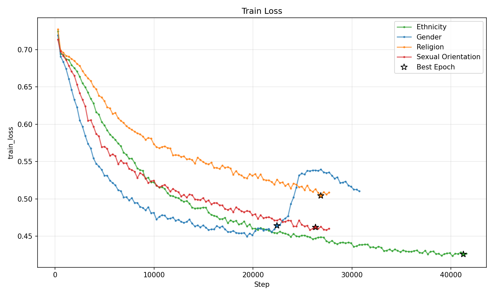
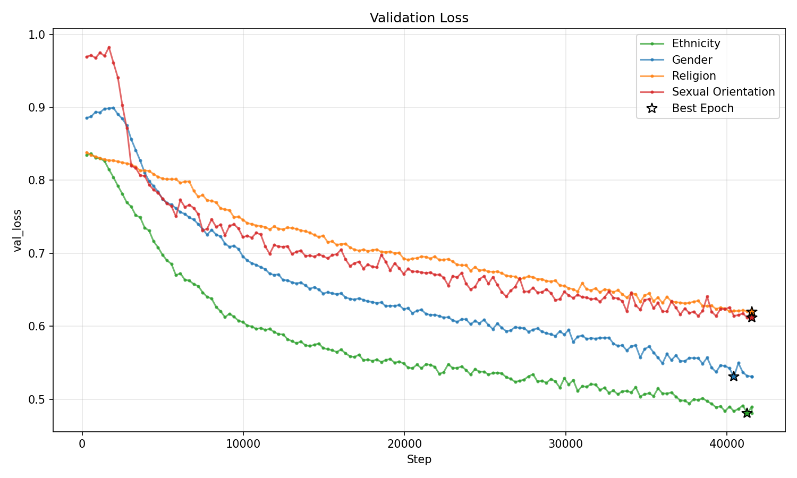
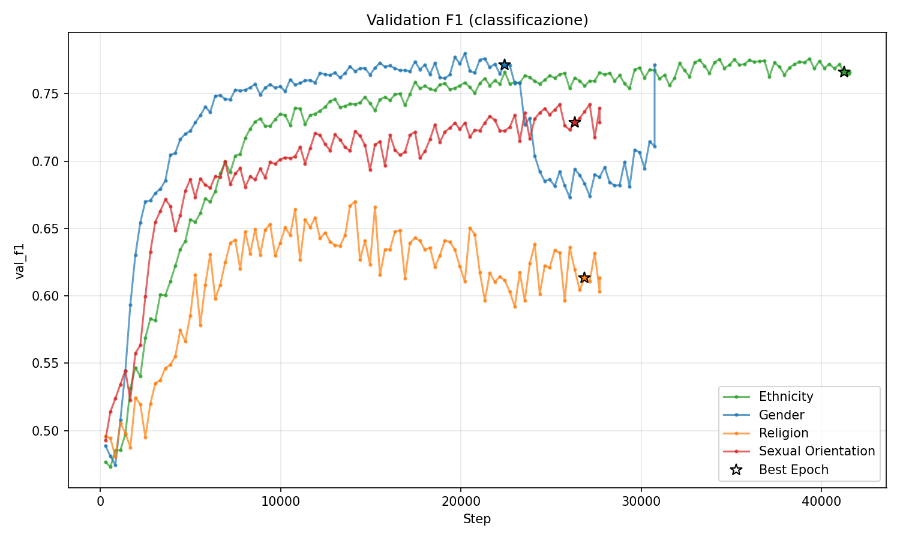
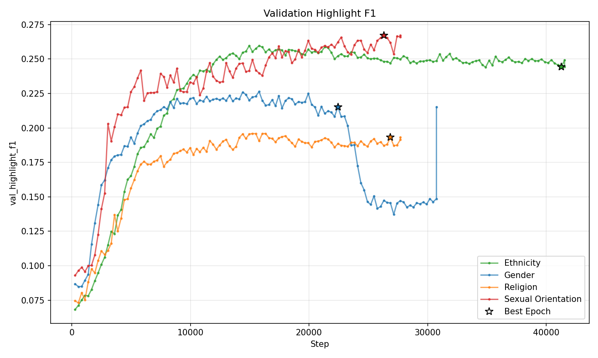
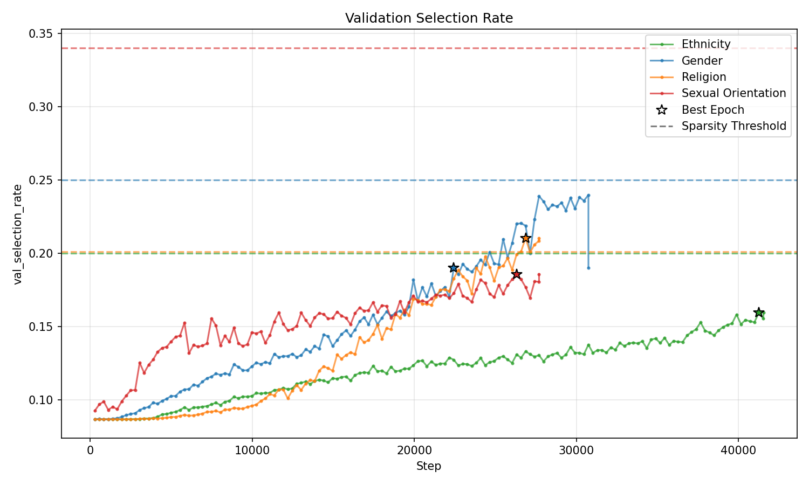

## Distribuzione Categorie e token medi
Selezionando solo le frasi di hate speech

len train_df: 17722 \
len val_df: 2176 \
len test1_df: 2259 \
len test2_df: 100 

media token: 23.934488206748675 

## distribuzione dei target nel train set

| categoria          |   %       |n. frasi presente |n. frasi totali train |
|:-------------------|----------:|-----------------:|---------------------:|
| Ethnicity          |      0.59 |            10547 |                17722 |  
| Gender             |      0.32 |             5706 |                17722 |  
| Religion           |      0.17 |             3022 |                17722 | 
| Sexual Orientation |      0.17 |              3011|                17722 |      

## token medi per componente nel gold test set

| categoria          |   n       |token medi/frase|highlight medi/frase |rapporto|
|:-------------------|----------:|-----------------:|---------------------:|---------------------:|
| Ethnicity          |      61 |            31.66 |                3.39 |  0.207|
| Gender             |      21 |             23.86 |               3.10 |  0.220|
| Religion           |      16 |            27.50 |                2.06 | 0.143|
| Sexual Orientation |      12 |              24.25|                4.00 |  0.28|

## Risultati run — Ethnicity (150 epoche, gli altri 100)

| Metric | Validation | Test |
|---|---|---|
| Loss | 0.481 | 0.520 |
| Classification loss | 0.425 | 0.465 |
| F1 | 0.766 | 0.747 |
| Highlight F1 | 0.244 | 0.257 |
| Sparsity | 0.055 | 0.055 |
| Selection rate | 0.160 | 0.161 |
| Selection size (media token) | 3.19 | 2.88 |

### prova contiguity

|Metric |  senza contiguity  | con contiguity |
|---|---|---|
| F1 classificazione | 0.747 | 0.751 |
| **Highlight F1** | **0.257** | **0.144** |
| Sparsity | 0.055 | 0.089 |
| Selection rate | 0.161 | 0.299 |
| Selection size (media token) | 2.88 | 4.54 |

## Risultati sul gold test set

| Test Metric            | Result                   | 
|:-----------------------|-------------------------:|
| test_classification    |  0.6120095252990723 |
| test_f1                |        0.730341911315918|
| test_highlight_f1      |    0.19426049292087555|
| test_loss              |      0.8267392516136169|
| test_selection_rate    |     0.13711871206760406|
| test_selection_size    |     3.640000104904175|
| test_sparsity          |  0.21472977101802826|

## Risultati run — Gender

| Metrica | Validation | Test |
|---|---|---|
| Loss | 0.523 | 0.553 |
| Classification loss | 0.440 | 0.475 |
| F1 | 0.772 | 0.728 |
| Highlight F1 | 0.215 | 0.259 |
| Sparsity | 0.082 | 0.079 |
| Selection rate | 0.190 | 0.195 |
| Selection size (media token) | 3.52 | 3.32 |

## Risultati sul gold test set

| Test Metric            | Result                   | 
|:-----------------------|-------------------------:|
| test_classification    |  0.5442148447036743|
| test_f1                |        0.6196785569190979|
| test_highlight_f1      |    0.2649572789669037
| test_loss              |     0.7432035207748413|
| test_selection_rate    |     0.15708158910274506|
| test_selection_size    |     4.050000190734863|
| test_sparsity          |  0.1989886462688446|

## Risultati run — Religion

| Metrica | Validation | Test |
|---|---|---|
| Loss | 0.596 | 0.581 |
| Classification loss | 0.536 | 0.514 |
| F1 | 0.613 | 0.641 |
| Highlight F1 | 0.193 | 0.232 |
| Sparsity | 0.060 | 0.067 |
| Selection rate | 0.210 | 0.233 |
| Selection size (media token) | 3.45 | 3.43 |

## Risultati sul gold test set

| Test Metric            | Result                   | 
|:-----------------------|-------------------------:|
| test_classification    |  0.5838398933410645|
| test_f1                |        0.5582120418548584|
| test_highlight_f1      |    0.16161616146564484|
| test_loss              |     0.8091709613800049|
| test_selection_rate    |     0.1449097990989685|
| test_selection_size    |     3.319999933242798|
| test_sparsity          |  0.22533109784126282|

## Risultati run — Sexual Orientation

| Metrica | Validation | Test |
|---|---|---|
| Loss | 0.641 | 0.609 |
| Classification loss | 0.464 | 0.442 |
| F1 | 0.729 | 0.715 |
| Highlight F1 | 0.267 | 0.316 |
| Sparsity | 0.176 | 0.167 |
| Selection rate | 0.186 | 0.194 |
| Selection size (media token) | 3.49 | 3.33 |

## Risultati sul gold test set

| Test Metric            | Result                   | 
|:-----------------------|-------------------------:|
| test_classification    |  0.48594599962234497|
| test_f1                |        0.7136858105659485|
| test_highlight_f1      |    0.3218390941619873|
| test_loss              |     0.6916424036026001|
| test_selection_rate    |     0.14617988467216492|
| test_selection_size    |     3.9100000858306885|
| test_sparsity          |  0.20569635927677155|

