## Distribuzione Categorie e token medi
Selezionando solo le frasi di hate speech

len train_df: 17722 \
len val_df: 2176 \
len test1_df: 2259 \
len test2_df: 100 

media token: 24

## distribuzione dei target nel train set

| categoria          |   %       |n. frasi presente |n. frasi totali train |
|:-------------------|----------:|-----------------:|---------------------:|
| Ethnicity          |      0.59 |            10547 |                17722 |  
| Gender             |      0.32 |             5706 |                17722 |  
| Religion           |      0.17 |             3022 |                17722 | 
| Sexual Orientation |      0.17 |              3011|                17722 |      

## token medi per componente nel gold test set

| categoria          |   n       |token medi/frase|highlight medi/frase |rapporto|
|:-------------------|----------:|-----------------:|---------------------:|---------------------:|
| Ethnicity          |      61 |            31.66 |                5.6 |  0.29|
| Gender             |      21 |             23.86 |               8.7 |  0.4|
| Religion           |      16 |            27.50 |                3.4 | 0.22|
| Sexual Orientation |      12 |              24.25|                5.2 |  0.3|

## Risultati run (150 epoche) — Ethnicity (lr 2e-4)

| Metric | Validation | Test |
|---|---|---|
| Loss | 0.462 ± 0.019 | 0.491 ± 0.018 |
| Classification loss | 0.417 ± 0.027 | 0.443 ± 0.023 |
| F1 | 0.775 ± 0.013 | 0.762 ± 0.020 |
| Highlight F1 | 0.238 ± 0.009 | 0.240 ± 0.008 |
| Sparsity | 0.045 ± 0.008 | 0.048 ± 0.008 |
| Selection rate | 0.181 ± 0.021 | 0.189 ± 0.024 |
| Selection rate pos | 0.169 ± 0.019 | 0.173 ± 0.022 |
| Selection rate neg | 0.198 ± 0.030 | 0.213 ± 0.030 |
| Selection size (media token)| 3.732 ± 0.163 | 3.466 ± 0.134 |

## con Conditional Sparsity

| Metric | Validation | Test |
|---|---|---|
| Loss | 0.585 ± 0.036 | 0.626 ± 0.038 |
| Classification loss | 0.491 ± 0.013 | 0.512 ± 0.013 |
| F1 | 0.720 ± 0.018 | 0.704 ± 0.024 |
| Highlight F1 | 0.227 ± 0.020 | 0.248 ± 0.023 |
| Sparsity | 0.092 ± 0.028 | 0.112 ± 0.028 |
| Selection rate | 0.166 ± 0.008 | 0.163 ± 0.009 |
| Selection rate pos | 0.209 ± 0.013 | 0.200 ± 0.015 |
| Selection rate neg | 0.102 ± 0.002 | 0.107 ± 0.006 |
| Selection size | 3.215 ± 0.178 | 2.801 ± 0.188 |

### prova contiguity

|Metric |  senza contiguity  | con contiguity |
|---|---|---|
| F1 classificazione | 0.747 | 0.751 |
| **Highlight F1** | **0.257** | **0.144** |
| Sparsity | 0.055 | 0.089 |
| Selection rate | 0.161 | 0.299 |
| Selection size (media token) | 2.88 | 4.54 |

## Risultati sul gold test set

| Test Metric            | Result                   | 
|:-----------------------|-------------------------:|
| test_classification    |            0.611 ± 0.026 |
| test_f1                |            0.731 ± 0.014 |
| test_highlight_f1      |            0.242 ± 0.035 |
| test_loss              |            0.764 ± 0.155 |
| test_selection_rate    |            0.149 ± 0.007 |
| test_selection_rate_neg|            0.152 ± 0.021 |
| test_selection_rate_pos|            0.147 ± 0.012 |
| test_selection_size    |            3.820 ± 0.231 |
| test_sparsity          |            0.153 ± 0.153 |

## con Conditional Sparsity

| Test Metric            | Result                   | 
|:-----------------------|-------------------------:|
| test_classification    |            0.606 ± 0.062 |
| test_f1                |            0.689 ± 0.044 |
| test_highlight_f1      |            0.236 ± 0.043 |
| test_loss              |            0.735 ± 0.130 |
| test_selection_rate    |            0.131 ± 0.014 |
| test_selection_rate_neg|            0.083 ± 0.005 |
| test_selection_rate_pos|            0.163 ± 0.019 |
| test_selection_size    |            3.843 ± 0.378 |
| test_sparsity          |            0.129 ± 0.122 |

## Risultati run — Gender (lr 1e-4)

| Metrica | Validation | Test |
|---|---|---|
| Loss | 0.564 ± 0.094 | 0.579 ± 0.087 |
| Classification loss | 0.460 ± 0.096 | 0.480 ± 0.090 |
| F1 | 0.753 ± 0.086 | 0.736 ± 0.085 |
| Highlight F1 | 0.202 ± 0.068 | 0.234 ± 0.081 |
| Sparsity | 0.105 ± 0.003 | 0.099 ± 0.003 |
| Selection rate | 0.167 ± 0.002 | 0.171 ± 0.002 |
| Selection rate pos | 0.145 ± 0.021 | 0.152 ± 0.022 |
| Selection rate neg | 0.179 ± 0.013 | 0.180 ± 0.012 |
| Selection size (media token)| 3.239 ± 0.296 | 3.024 ± 0.297 |

## con conditional sparsity

| Metrica | Validation | Test |
|---|---|---|
| Loss | 0.624 ± 0.013 | 0.664 ± 0.012 |
| Classification loss | 0.482 ± 0.008 | 0.508 ± 0.011 |
| F1 | 0.780 ± 0.004 | 0.757 ± 0.013 |
| Highlight F1 | 0.291 ± 0.014 | 0.328 ± 0.007 |
| Sparsity | 0.144 ± 0.011 | 0.155 ± 0.005 |
| Selection rate | 0.151 ± 0.008 | 0.158 ± 0.004 |
| Selection rate pos | 0.241 ± 0.024 | 0.264 ± 0.013 |
| Selection rate neg | 0.105 ± 0.001 | 0.111 ± 0.002 |
| Selection size | 2.943 ± 0.154 | 2.700 ± 0.087 |

## Risultati sul gold test set

| Test Metric            | Result                   | 
|:-----------------------|-------------------------:|
| test_classification    |            0.596 ± 0.103 |
| test_f1                |            0.588 ± 0.084 |
| test_highlight_f1      |            0.226 ± 0.043 |
| test_loss              |            0.805 ± 0.109 |
| test_selection_rate    |            0.138 ± 0.016 |
| test_selection_rate_neg|            0.145 ± 0.017 |
| test_selection_rate_pos|            0.112 ± 0.009 |
| test_selection_size    |            3.587 ± 0.435 |
| test_sparsity          |            0.209 ± 0.140 |

## con Conditional Sparsity

| Test Metric            | Result                   | 
|:-----------------------|-------------------------:|
| test_classification    |            0.526 ± 0.011 |
| test_f1                |            0.712 ± 0.015 |
| test_highlight_f1      |            0.387 ± 0.033 |
| test_loss              |            0.693 ± 0.034 |
| test_selection_rate    |            0.105 ± 0.010 |
| test_selection_rate_neg|            0.073 ± 0.003 |
| test_selection_rate_pos|            0.224 ± 0.039 |
| test_selection_size    |            2.157 ± 0.245 |
| test_sparsity          |            0.167 ± 0.024 |

## Risultati run — Religion (lr 1e-4)

| Metrica | Validation | Test |
|---|---|---|
| Loss | 0.599 ± 0.023 | 0.570 ± 0.038 |
| Classification loss | 0.529 ± 0.013 | 0.503 ± 0.025 |
| F1 | 0.651 ± 0.012 | 0.664 ± 0.007 |
| Highlight F1 | 0.192 ± 0.005 | 0.224 ± 0.005 |
| Sparsity | 0.070 ± 0.014 | 0.067 ± 0.014 |
| Selection rate | 0.166 ± 0.018 | 0.176 ± 0.019 |
| Selection rate pos | 0.146 ± 0.018 | 0.158 ± 0.019 |
| Selection rate neg | 0.170 ± 0.018 | 0.180 ± 0.020 |
| Selection size (media token)| 2.823 ± 0.672 | 2.719 ± 0.587 |

## con conditional sparsity

| Metrica | Validation | Test |
|---|---|---|
| Loss | 0.688 ± 0.003 | 0.715 ± 0.013 |
| Classification loss | 0.523 ± 0.008 | 0.533 ± 0.005 |
| F1 | 0.673 ± 0.006 | 0.677 ± 0.015 |
| Highlight F1 | 0.228 ± 0.012 | 0.260 ± 0.023 |
| Sparsity | 0.166 ± 0.005 | 0.183 ± 0.011 |
| Selection rate | 0.114 ± 0.002 | 0.119 ± 0.003 |
| Selection rate pos | 0.215 ± 0.012 | 0.227 ± 0.013 |
| Selection rate neg | 0.095 ± 0.001 | 0.098 ± 0.001 |
| Selection size | 1.675 ± 0.068 | 1.650 ± 0.084 |

## Risultati sul gold test set

| Test Metric            | Result                   | 
|:-----------------------|-------------------------:|
| test_classification    |            0.581 ± 0.033 |
| test_f1                |            0.590 ± 0.032 |
| test_highlight_f1      |            0.210 ± 0.016 |
| test_loss              |            0.701 ± 0.024 |
| test_selection_rate    |            0.109 ± 0.013 |
| test_selection_rate_neg|            0.111 ± 0.015 |
| test_selection_rate_pos|            0.103 ± 0.008 |
| test_selection_size    |            2.320 ± 0.335 |
| test_sparsity          |            0.120 ± 0.012 |

## con Conditional Sparsity

| Test Metric            | Result                   | 
|:-----------------------|-------------------------:|
| test_classification    |            0.566 ± 0.005 |
| test_f1                |            0.596 ± 0.018 |
| test_highlight_f1      |            0.264 ± 0.069 |
| test_loss              |            0.705 ± 0.006 |
| test_selection_rate    |            0.078 ± 0.004 |
| test_selection_rate_neg|            0.067 ± 0.003 |
| test_selection_rate_pos|            0.136 ± 0.016 |
| test_selection_size    |            1.793 ± 0.105 |
| test_sparsity          |            0.137 ± 0.004 |

## Risultati run — Sexual Orientation (lr 2e-4)

| Metrica | Validation | Test |
|---|---|---|
| Loss | 0.513 ± 0.032 | 0.496 ± 0.030 |
| Classification loss | 0.442 ± 0.035 | 0.423 ± 0.023 |
| F1 | 0.748 ± 0.019 | 0.742 ± 0.006 |
| Highlight F1 | 0.292 ± 0.011 | 0.329 ± 0.024 |
| Sparsity | 0.070 ± 0.044 | 0.073 ± 0.043 |
| Selection rate | 0.288 ± 0.050 | 0.291 ± 0.048 |
| Selection rate pos | 0.283 ± 0.048 | 0.300 ± 0.045 |
| Selection rate neg | 0.289 ± 0.051 | 0.289 ± 0.049 |
| Selection size (media token)| 6.573 ± 0.968 | 5.951 ± 0.786 |

## con conditional sparsity

| Metrica | Validation | Test |
|---|---|---|
| Loss | 0.658 ± 0.028 | 0.659 ± 0.039 |
| Classification loss | 0.468 ± 0.028 | 0.450 ± 0.029 |
| F1 | 0.767 ± 0.016 | 0.761 ± 0.017 |
| Highlight F1 | 0.340 ± 0.009 | 0.356 ± 0.027 |
| Sparsity | 0.190 ± 0.007 | 0.206 ± 0.018 |
| Selection rate | 0.146 ± 0.006 | 0.154 ± 0.004 |
| Selection rate pos | 0.352 ± 0.006 | 0.384 ± 0.004 |
| Selection rate neg | 0.104 ± 0.007 | 0.107 ± 0.008 |
| Selection size | 2.619 ± 0.217 | 2.545 ± 0.179 |

## Risultati sul gold test set

| Test Metric            | Result                   | 
|:-----------------------|-------------------------:|
| test_classification    |            0.473 ± 0.086 |
| test_f1                |            0.707 ± 0.020 |
| test_highlight_f1      |            0.386 ± 0.038 |
| test_loss              |            0.630 ± 0.122 |
| test_selection_rate    |            0.242 ± 0.072 |
| test_selection_rate_neg|            0.242 ± 0.071 |
| test_selection_rate_pos|            0.238 ± 0.083 |
| test_selection_size    |            6.773 ± 2.209 |
| test_sparsity          |            0.155 ± 0.150 |

## con Conditional Sparsity

| Test Metric            | Result                   | 
|:-----------------------|-------------------------:|
| test_classification    |            0.505 ± 0.062 |
| test_f1                |            0.708 ± 0.025 |
| test_highlight_f1      |            0.277 ± 0.032 |
| test_loss              |            0.721 ± 0.142 |
| test_selection_rate    |            0.099 ± 0.005 |
| test_selection_rate_neg|            0.072 ± 0.002 |
| test_selection_rate_pos|            0.298 ± 0.049 |
| test_selection_size    |            2.373 ± 0.186 |
| test_sparsity          |            0.215 ± 0.084 |

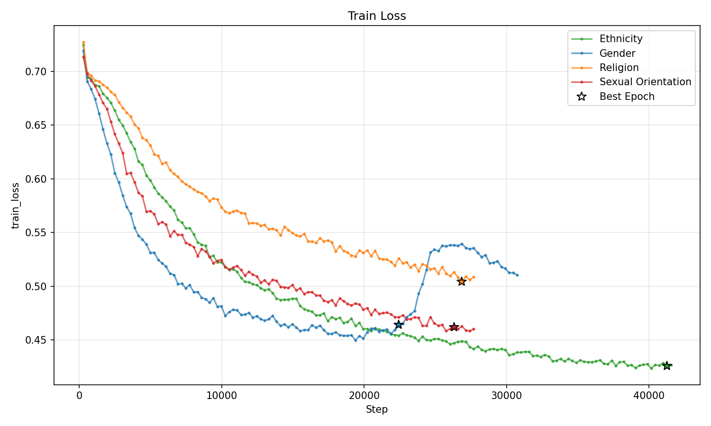

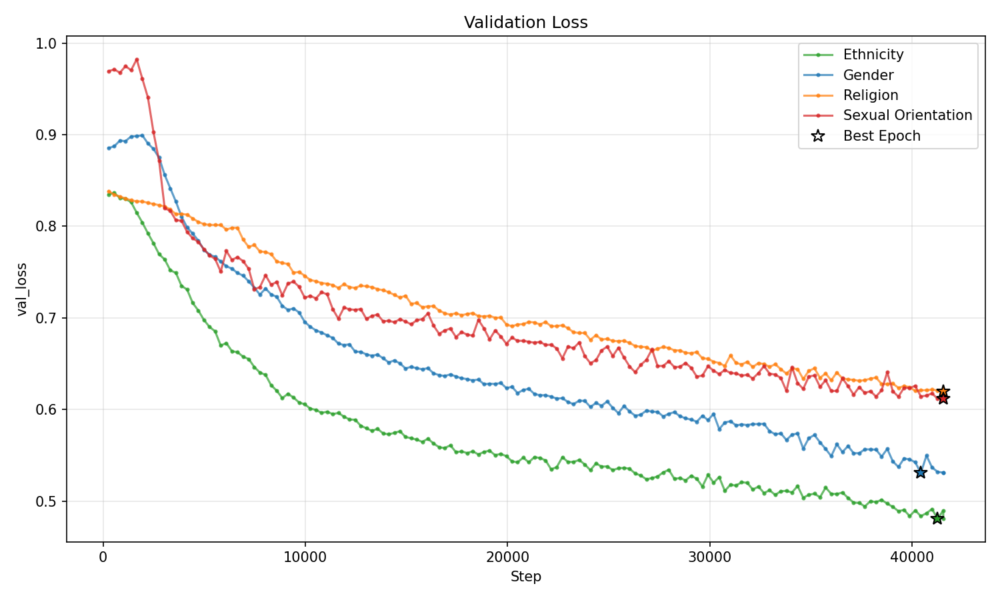

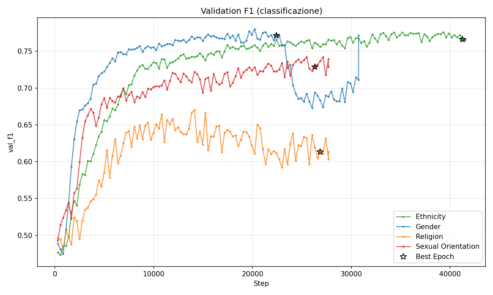

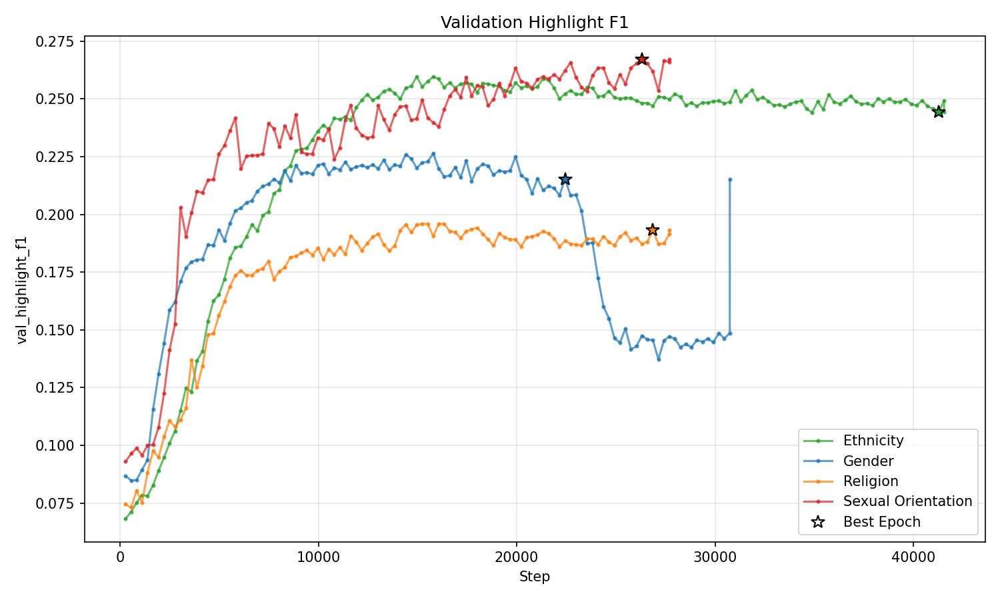

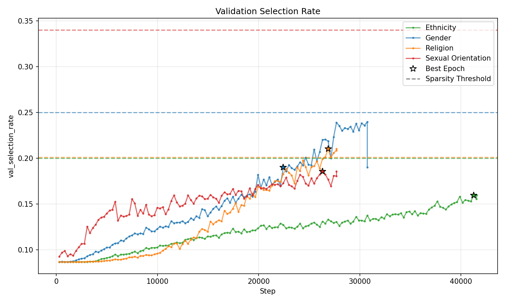

## plots conditional sparsity

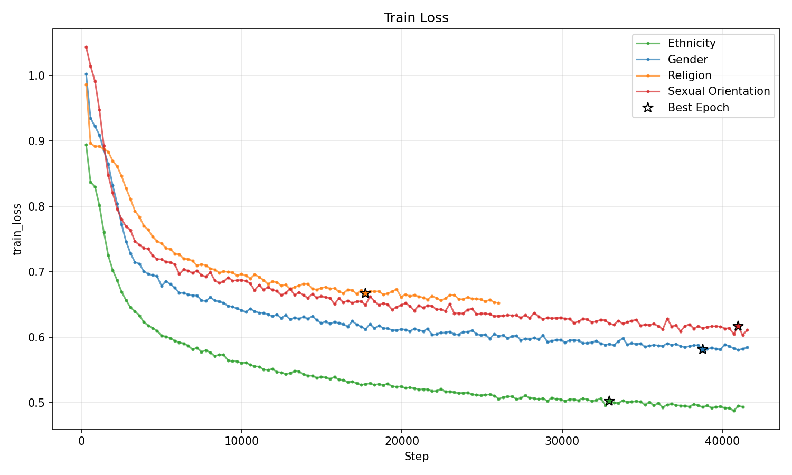

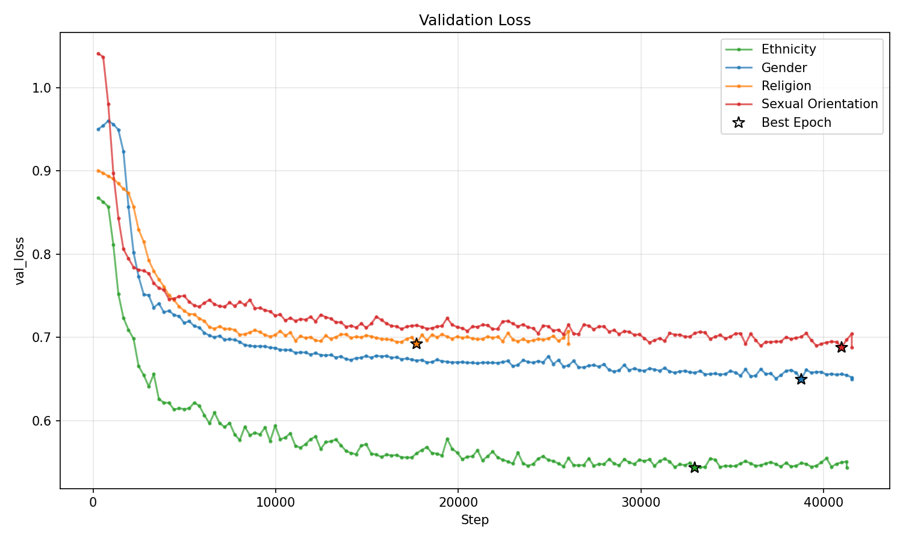

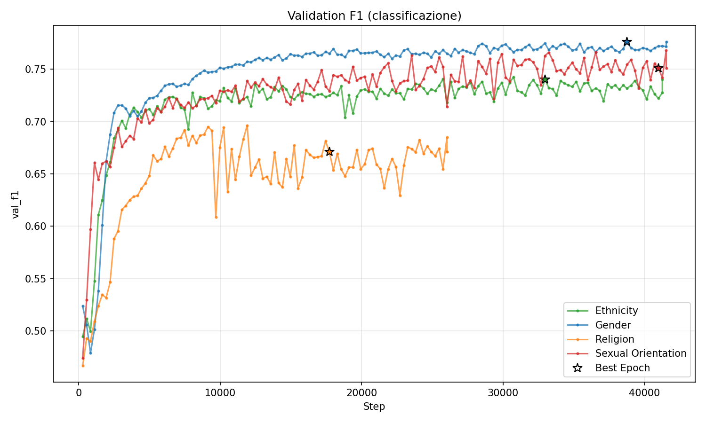

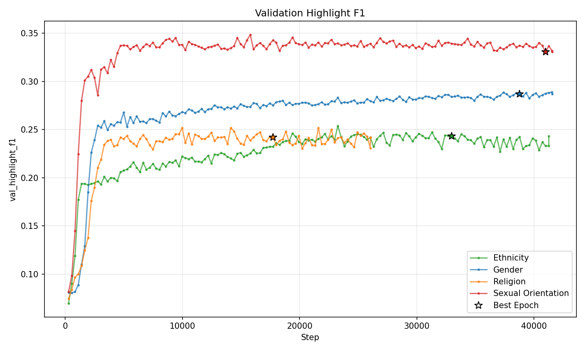

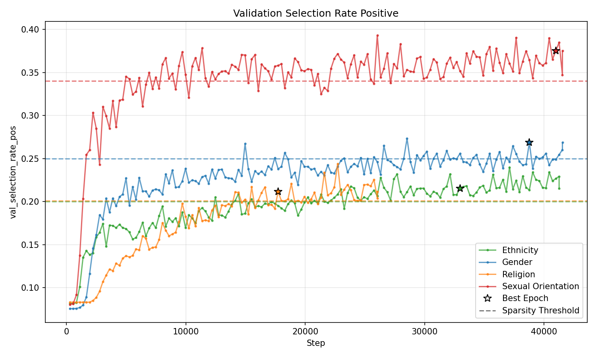

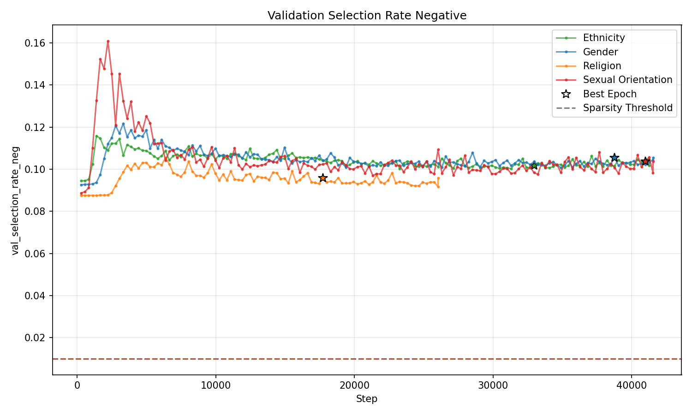
