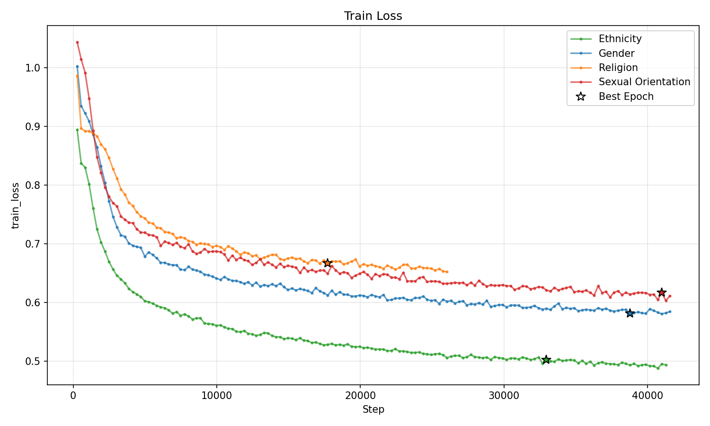
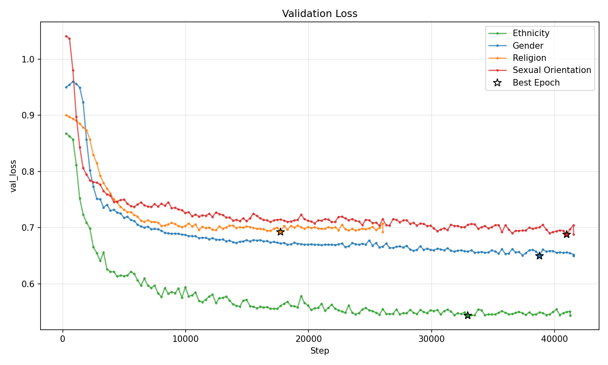
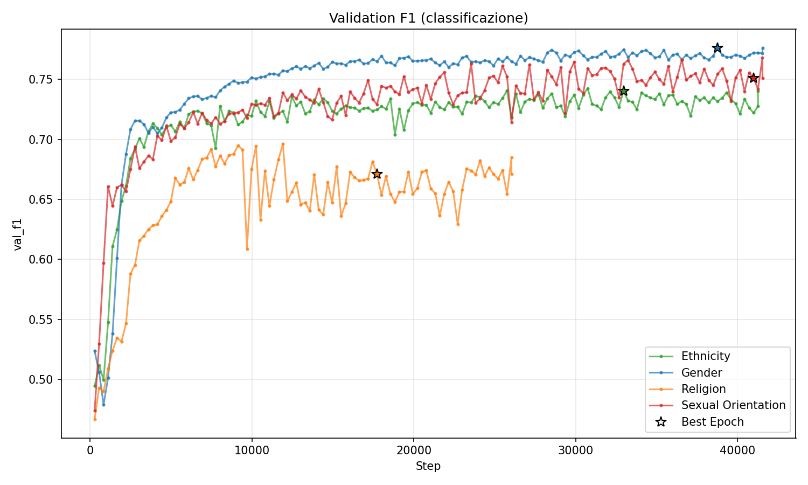
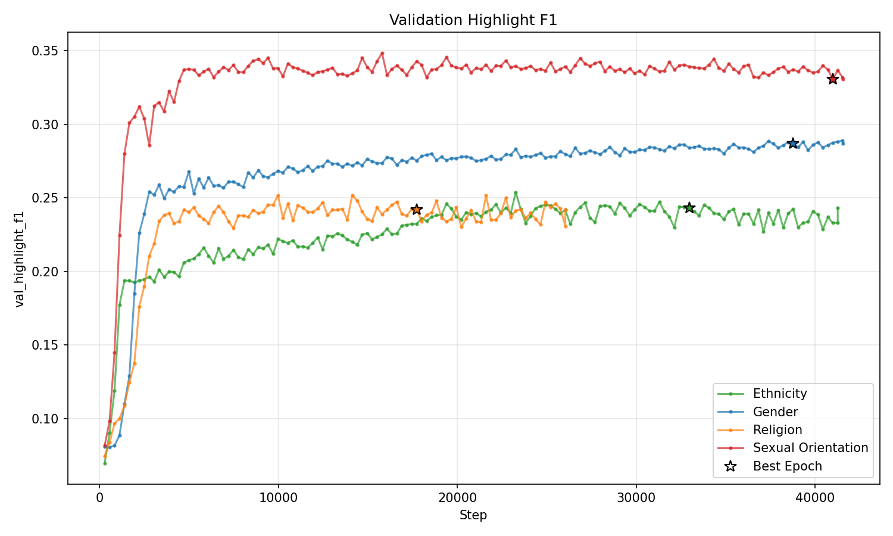
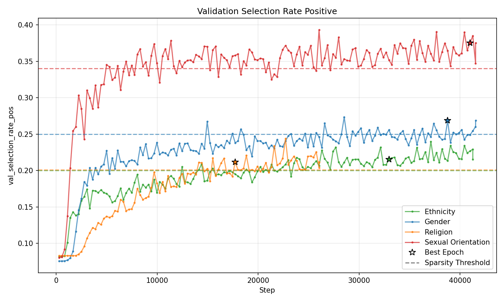
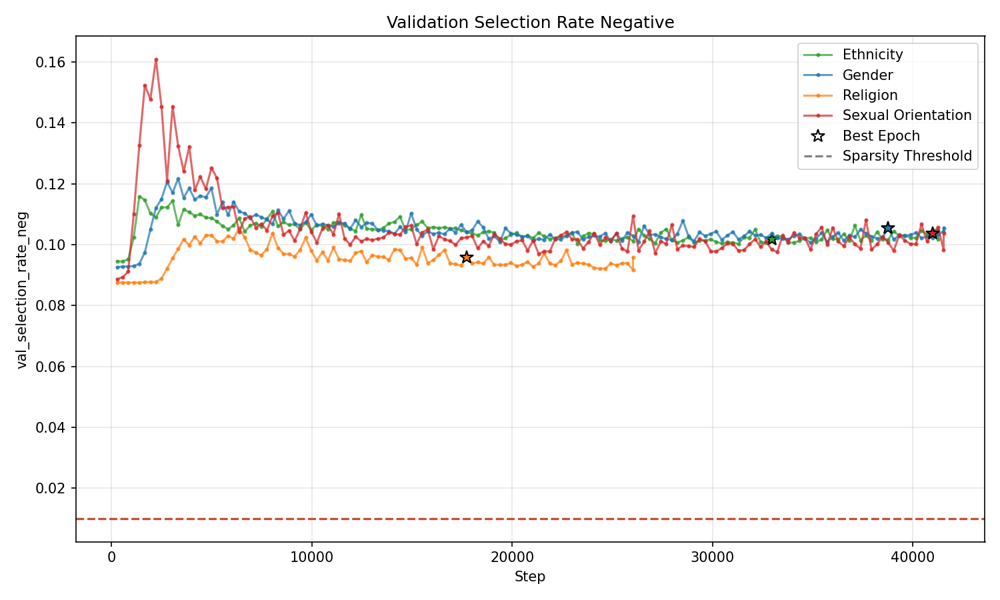

## Distribuzione Categorie e token medi
Selezionando solo le frasi di hate speech

len train_df: 17722 \
len val_df: 2176 \
len test1_df: 2259 \
len test2_df: 100 

media token: 24

## distribuzione dei target nel train set

| categoria          |   %       |n. frasi presente |n. frasi totali train |
|:-------------------|----------:|-----------------:|---------------------:|
| Ethnicity          |      0.59 |            10547 |                17722 |  
| Gender             |      0.32 |             5706 |                17722 |  
| Religion           |      0.17 |             3022 |                17722 | 
| Sexual Orientation |      0.17 |              3011|                17722 |      

## token medi per componente nel gold test set

| categoria          |   n       |token medi/frase|highlight medi/frase |rapporto|
|:-------------------|----------:|-----------------:|---------------------:|---------------------:|
| Ethnicity          |      61 |            31.66 |                5.6 |  0.29|
| Gender             |      21 |             23.86 |               8.7 |  0.4|
| Religion           |      16 |            27.50 |                3.4 | 0.22|
| Sexual Orientation |      12 |              24.25|                5.2 |  0.3|

## Risultati run (150 epoche) — Ethnicity (lr 2e-4)

| Metric | Validation | Test |
|---|---|---|
| Loss | 0.481 | 0.520 |
| Classification loss | 0.425 | 0.465 |
| F1 | 0.766 | 0.747 |
| Highlight F1 | 0.244 | 0.257 |
| Sparsity | 0.055 | 0.055 |
| Selection rate | 0.160 | 0.161 |
| Selection size| 3.19 | 2.88 |

### prova contiguity

|Metric |  senza contiguity  | con contiguity |
|---|---|---|
| F1 classificazione | 0.747 | 0.751 |
| **Highlight F1** | **0.257** | **0.144** |
| Sparsity | 0.055 | 0.089 |
| Selection rate | 0.161 | 0.299 |
| Selection size (media token) | 2.88 | 4.54 |

## con Conditional Sparsity

| Metric | Validation | Test |
|---|---|---|
| Loss | 0.543 | 0.583 |
| Classification loss | 0.478 | 0.498 |
| F1 | 0.74 | 0.73 |
| Highlight F1 | 0.243 | 0.264 |
| Sparsity | 0.06 | 0.08 |
| Selection rate | 0.169 | 0.160 |
|Selection rate pos| 0.215 |0.197 |
| Selection rate neg| 0.10 |0.10 |
| Selection size| 3.156 | 2.66|

## Risultati sul gold test set

| Test Metric            | Result                   | 
|:-----------------------|-------------------------:|
| test_classification    |  0.61|
| test_f1                |        0.73|
| test_highlight_f1      |    0.245|
| test_loss              |      0.94|
| test_selection_rate    |     0.14|
| test_selection_rate_neg    |     0.14|
| test_selection_rate_pos    |     0.14|
| test_selection_size    |     3.64|
| test_sparsity          |  0.33|

## con Conditional Sparsity

| Test Metric            | Result                   | 
|:-----------------------|-------------------------:|
| test_classification    |  0.60|
| test_f1                |        0.722|
| test_highlight_f1      |    0.286|
| test_loss              |      0.87|
| test_selection_rate    |     0.12|
| test_selection_rate_neg    |     0.08|
| test_selection_rate_pos    |     0.15|
| test_selection_size    |     3.44|
| test_sparsity          |  0.27|

## Risultati run — Gender (lr 1e-4)

| Metrica | Validation | Test |
|---|---|---|
| Loss | 0.53 | 0.55 |
| Classification loss | 0.44 | 0.46 |
| F1 | 0.78 | 0.74 |
| Highlight F1 | 0.22 | 0.26 |
| Sparsity | 0.09 | 0.08 |
| Selection rate | 0.18 | 0.19 |
|Selection rate pos| 0.15 |0.16 |
| Selection rate neg| 0.198 |0.2 |
| Selection size | 3.33 | 3.16 |

## con conditional sparsity

| Metrica | Validation | Test |
|---|---|---|
| Loss | 0.64 | 0.666 |
| Classification loss | 0.49 | 0.515 |
| F1 | 0.776 | 0.768 |
| Highlight F1 | 0.287 | 0.326 |
| Sparsity | 0.156 | 0.15 |
| Selection rate | 0.16 | 0.16 |
|Selection rate pos| 0.268 |0.274 |
| Selection rate neg| 0.106 |0.109 |
| Selection size | 3.12 | 2.78 |

## Risultati sul gold test set

| Test Metric            | Result                   | 
|:-----------------------|-------------------------:|
| test_classification    |  0.53|
| test_f1                |        0.628|
| test_highlight_f1      |    0.274|
| test_loss              |     0.90|
| test_selection_rate    |     0.146|
| test_selection_rate_neg    |     0.1533|
| test_selection_rate_pos    |     0.117|
| test_selection_size    |     3.77|
| test_sparsity          |  0.37|

## Conditional Sparsity

| Test Metric            | Result                   | 
|:-----------------------|-------------------------:|
| test_classification    |  0.515|
| test_f1                |        0.728|
| test_highlight_f1      |    0.425|
| test_loss              |     0.655|
| test_selection_rate    |     0.117|
| test_selection_rate_neg    |     0.077|
| test_selection_rate_pos    |     0.268|
| test_selection_size    |     2.44|
| test_sparsity          |  0.14|

## Risultati run — Religion (lr 1e-4)

| Metrica | Validation | Test |
|---|---|---|
| Loss | 0.619 | 0.598 |
| Classification loss | 0.543 | 0.523 |
| F1 | 0.614 | 0.644 |
| Highlight F1 | 0.194 | 0.238 |
| Sparsity | 0.076 | 0.075 |
| Selection rate | 0.17 | 0.19 |
|Selection rate pos| 0.155 |0.175 |
| Selection rate neg| 0.176 |0.197 |
| Selection size | 2.55 | 2.58 |

## con conditional sparsity

| Metrica | Validation | Test |
|---|---|---|
| Loss | 0.69 | 0.70 |
| Classification loss | 0.532 | 0.532 |
| F1 | 0.67 | 0.673 |
| Highlight F1 | 0.242 | 0.282 |
| Sparsity | 0.16 | 0.17 |
| Selection rate | 0.114 | 0.117 |
|Selection rate pos| 0.211 |0.218 |
| Selection rate neg| 0.096 |0.097 |
| Selection size | 1.68| 1.64 |

## Risultati sul gold test set

| Test Metric            | Result                   | 
|:-----------------------|-------------------------:|
| test_classification    |  0.60|
| test_f1                |        0.553|
| test_highlight_f1      |    0.195|
| test_loss              |     0.72|
| test_selection_rate    |     0.109|
| test_selection_rate_neg    |     0.109|
| test_selection_rate_pos   |     0.11|
| test_selection_size    |     2.31|
| test_sparsity          |  0.120|

## Conditional Sparsity

| Test Metric            | Result                   | 
|:-----------------------|-------------------------:|
| test_classification    |  0.57|
| test_f1                |        0.588|
| test_highlight_f1      |    0.1935|
| test_loss              |     0.707|
| test_selection_rate    |     0.08|
| test_selection_rate_neg    |     0.07|
| test_selection_rate_pos   |     0.13|
| test_selection_size    |     1.9|
| test_sparsity          |  0.133|

## Risultati run — Sexual Orientation (lr 2e-4)

| Metrica | Validation | Test |
|---|---|---|
| Loss | 0.611 | 0.56 |
| Classification loss | 0.470 | 0.43 |
| F1 | 0.755 | 0.742 |
| Highlight F1 | 0.280 | 0.338 |
| Sparsity | 0.141 | 0.13 |
| Selection rate | 0.218 | 0.22 |
|Selection rate pos| 0.225 |0.237 |
| Selection rate neg| 0.217 |0.227 |
| Selection size (media token) | 4.34 | 4.06 |

## con conditional sparsity

| Metrica | Validation | Test |
|---|---|---|
| Loss | 0.688 | 0.70 |
| Classification loss | 0.487 | 0.459 |
| F1 | 0.751 | 0.748 |
| Highlight F1 | 0.33 | 0.376 |
| Sparsity | 0.20 | 0.24 |
| Selection rate | 0.15 | 0.16 |
|Selection rate pos| 0.375 |0.419 |
| Selection rate neg| 0.103 |0.11 |
| Selection size (media token) | 2.57 | 2.59 |

## Risultati sul gold test set

| Test Metric            | Result                   | 
|:-----------------------|-------------------------:|
| test_classification    |  0.44|
| test_f1                |        0.709|
| test_highlight_f1      |    0.396|
| test_loss              |     0.766|
| test_selection_rate    |     0.174|
| test_selection_rate_neg    |     0.174|
| test_selection_rate_pos    |     0.169|
| test_selection_size    |     4.8|
| test_sparsity          |  0.32|

## Conditional Sparsity

| Test Metric            | Result                   | 
|:-----------------------|-------------------------:|
| test_classification    |  0.44|
| test_f1                |        0.735|
| test_highlight_f1      |    0.24|
| test_loss              |     0.56|
| test_selection_rate    |     0.10|
| test_selection_rate_neg    |     0.07|
| test_selection_rate_pos    |     0.32|
| test_selection_size    |     2.57|
| test_sparsity          |  0.118|

## plots conditional sparsity

